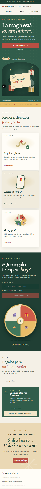
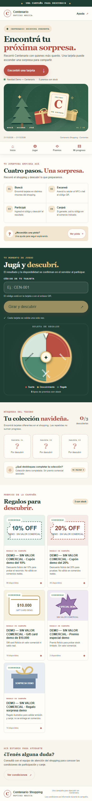
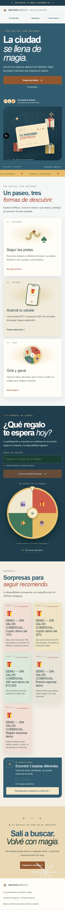
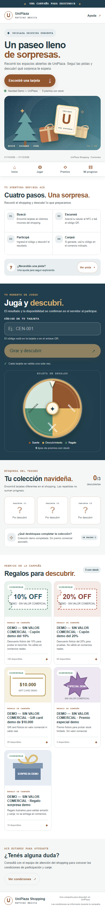

# Rediseño UX de la campaña navideña

## Dirección y alcance

Se reemplazó la composición editorial por una experiencia mobile-first de búsqueda y juego. Las páginas `/centenario` y `/uniplaza` siguen usando el mismo árbol de componentes y APIs, con tema explícito por shopping y datos de campaña obtenidos del servidor. La ruta NFC/QR conserva su flujo de participación existente.

Centenario mantiene una escena de jardín navideño con verde profundo y acentos cálidos; UniPlaza usa una escena urbana abierta con azules y cobre. Estos son temas de campaña aproximados, no una afirmación sobre paletas corporativas oficiales. La inspección de recursos no encontró logos oficiales ni manuales de marca en el repositorio; se usa una marca tipográfica provisional fácilmente reemplazable. Ver [brand-guidelines.md](../brand-guidelines.md) para fuentes y limitaciones.

## Recorrido actualizado

- Header compacto y navegación inferior fija durante el desplazamiento móvil.
- Hero corto con acción directa a participación.
- Instrucciones de cuatro pasos y pista programada desde la API.
- Juego con entrada de tarjeta; el resultado y stock vienen del servidor. El estado de éxito no se reemplaza al refrescar disponibilidad.
- Colección de espacios visuales basada en el progreso persistido del participante.
- Galería con imágenes configuradas, stock real y estados agotados.
- Ayuda, bases y pie con la marca correspondiente.

No se agregaron premios de producción ni se cambió la lógica de asignación. Las capturas locales de QA pueden mostrar premios DEMO marcados expresamente “SIN VALOR COMERCIAL”.

## Capturas comparativas

Capturadas con Playwright en 390 × 844 (móvil) y 1440 × 1000 (escritorio). Las capturas antes/después utilizan el mismo viewport y rutas.

| Shopping | Móvil antes | Móvil después | Escritorio antes | Escritorio después |
|---|---|---|---|---|
| Centenario |  |  | [Ver captura](before-centenario-desktop.png) | [Ver captura](after-centenario-desktop.png) |
| UniPlaza |  |  | [Ver captura](before-uniplaza-desktop.png) | [Ver captura](after-uniplaza-desktop.png) |

## Verificación

- Responsive y aislamiento de tema: 320, 360, 375, 390, 430, 768, 1024, 1280, 1440 y 1920 px.
- Ruleta acotada a 320 px y foco de teclado visible.
- Orientación horizontal (844 × 390), zoom de texto y `prefers-reduced-motion`.
- Axe WCAG 2.2 AA sobre las rutas públicas y el acceso administrativo.
- `npm test`: 6 aprobadas, 1 prueba QA omitida en modo general. Incluye responsive, selección de tema, Axe y capturas.
- `npm run test:qa`: 1 aprobada contra PostgreSQL QA local. Verificó semilla repetible, participación desde la landing y ruta NFC, stock, aislamiento cross-tenant y canje de un solo uso.
- `npx tsc --noEmit`: aprobado. `npm run lint`: 0 errores y 2 advertencias de `` en utilidades del panel QA. `npm run build`: compilación de producción exitosa; conserva esas 2 advertencias de lint.
- Capturas generadas con campaña DEMO QA; no representan premios activos de producción.

## Recursos de marca pendientes

- Logotipo oficial autorizado de Centenario Shopping (versiones claro/oscuro y formatos SVG/PNG).
- Logotipo oficial autorizado de UniPlaza Shopping (versiones claro/oscuro y formatos SVG/PNG).
- Manuales de identidad vigentes, tipografías licenciadas y fotografía promocional aprobada de cada shopping.

